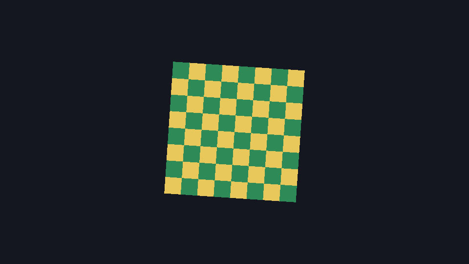

# SDL3 GPU for Beginners

A small C++20 tutorial: open a window, create an SDL GPU device, and draw a spinning textured quad. The same code runs on Vulkan, Direct3D 12, and Metal. SDL3 core only. No engine, no SDL_mixer, no image library.



**New here?** Let an AI assistant do the build setup, then check its work against a short list. The [guide](docs/guide.md) has paste-ready prompts and that checklist. Hand-written CMake is an appendix, for when you want to see what the assistant did.

**Stay current.** Assistants often suggest an old SDL tag, SDL2 packages, or stale CMake. Before you build, paste: `Check that this project uses the latest stable SDL3 release and current CMake setup; update anything outdated before building.` Ask it to confirm SDL_shadercross, the CMake minimum, and the install steps as well.

## Build and run

You need CMake 3.24 or newer, a C++20 compiler, and a GPU (Lavapipe is enough on Linux). The default build downloads [SDL 3.4.16](https://github.com/libsdl-org/SDL/releases/tag/release-3.4.16) and checks its SHA256. Nothing else is fetched.

```sh
cmake --preset debug
cmake --build --preset debug
```

The executable is `./out/debug/quad` with Makefiles or Ninja, and `out\debug\Debug\quad.exe` with Visual Studio. Release is the same path with `release` in place of `debug`.

```sh
GUIDE_FRAMES=120 ./out/debug/quad   # quit after 120 frames
```

The log line `GPU driver: vulkan` (or `direct3d12`, or `metal`) means SDL picked a backend. You should see the checkerboard spinning on a dark window.

Already have SDL3 installed? Configure with `-DUSE_SYSTEM_SDL3=ON`.

Linux needs the usual X11/Wayland and Vulkan headers before SDL will configure. The [guide's appendix](docs/guide.md#appendix-a-under-the-hood-diy-build-setup) lists them, including `libxtst-dev` on Debian.

## Shaders

`shaders/` holds the HLSL source and precompiled SPIR-V, DXIL, and MSL, so Windows and macOS can run without extra tools. If `shadercross` from [SDL_shadercross](https://github.com/libsdl-org/SDL_shadercross) is on your `PATH`, the build recompiles the HLSL (that is the `COMPILE_SHADERS` option, on by default). Pass `-DCOMPILE_SHADERS=OFF` to always use the committed bytecode.

## What's next

Part 0 is this quad. The follow-up is a classic vector Asteroids game on the same setup: line-list drawing, a fixed timestep, rocks that split, and sound through SDL3's own audio streams. Every later part is **planned**. There are no dates.

| Part | Title | Status |
| --- | --- | --- |
| 0 | Window, device, pipeline, textured quad | this repo |
| 1 | Vector ship as a line list | planned |
| 2 | Fixed timestep, input, thrust, rotation, wrap | planned |
| 3 | Dynamic vertex buffer | planned |
| 4 | Bullets | planned |
| 5 | Asteroids and splitting | planned |
| 6 | Collisions | planned |
| 7 | Score, lives, waves, UI | planned |
| 8 | Audio with core audio streams | planned |
| 9 | Juice: debris, shake, glow | planned |
| 10 | Polish and a shareable build | planned |

The per-part notes are in the [series outline](docs/series-outline.md).

## License

[MIT](LICENSE). The sample, the guide, the shaders, and the pictures in this repo are original.
