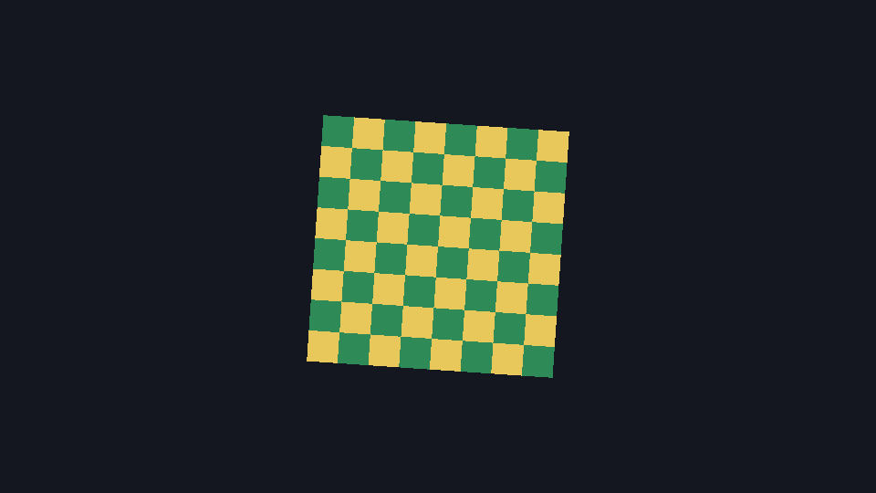
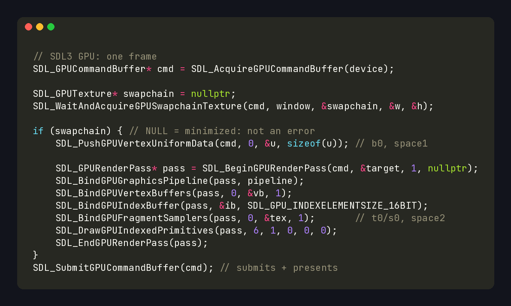

# SDL3 GPU for Beginners: From Window to Textured Quad

*Written in clean, minimal C++20 with plain SDL3 and no engine. Every SDL function used here was checked against the SDL3 wiki and compiled against real SDL3 headers.*



By the end you'll have one `src/main.cpp` (about 370 lines, comments included) and two tiny HLSL shaders that:

- open a window and create a GPU device (Vulkan, Direct3D 12, or Metal, picked by SDL),
- upload a vertex buffer, an index buffer, and a texture,
- draw a spinning textured quad every frame, and
- shut down cleanly.

This is the same path a real engine takes. Each section links to the matching file in [Emerald](https://github.com/Ridejock/Emerald), a small open-source C++20 engine built on SDL GPU, if you want to see the "grown-up" version. You don't need Emerald for anything here.

---

## 0. Setup: let an AI assistant do the plumbing (recommended)

Build setup (CMake, fetching SDL3, compiling shaders) is the least interesting part of graphics programming, and it's exactly where beginners lose a weekend. Our advice: **let an AI coding assistant generate the project scaffolding, and spend your energy on the SDL GPU code.** An AI speeds up setup, but you should still read every line it writes. If you can't explain a line, ask the assistant what it does before you keep it.

This repository already contains a working setup (`CMakeLists.txt`, `CMakePresets.json`, and precompiled shaders). You can build it from the [README](../README.md), or paste the prompts below into an assistant and recreate it yourself. Either way, run the checklist before you trust the project.

### Prompts you can paste

**Prompt 1: project skeleton**

> Create a minimal C++20 CMake project called `sdl3_gpu_quad` with a single `src/main.cpp`. Fetch SDL3 with CMake `FetchContent` from the official release tarball. Pin the latest stable SDL3 release (not SDL2, and not `main`) with a `URL_HASH SHA256`. Build SDL statically and turn off SDL tests and examples. Add an option `USE_SYSTEM_SDL3` that uses `find_package(SDL3 CONFIG)` instead. Add a `CMakePresets.json` with `debug` and `release` presets. Use warnings `/W4 /permissive-` on MSVC and `-Wall -Wextra -Wpedantic` elsewhere. Do not use SDL_mixer, SDL_image, or any other SDL satellite library. Use only SDL3 core. The copy of this project in the repo pins SDL 3.4.16; replace that pin if it is no longer the latest stable.

**Prompt 2: shader step**

> Add a CMake option `COMPILE_SHADERS` that defaults to ON. When it is ON and the `shadercross` CLI from SDL_shadercross is on PATH, add a post-build step that compiles `shaders/Quad.vert.hlsl` (vertex) and `shaders/Quad.frag.hlsl` (fragment) into SPIRV, DXIL, and MSL. Use `-s HLSL -d <FORMAT> -t <vertex|fragment> -e main -o <file>`. Write the results to a `shaders/` folder next to the executable as `Quad.vert.spv`, `.dxil`, `.msl` (and the same for frag). If the option is OFF, or `shadercross` isn't found, copy any precompiled files from the source `shaders/` folder instead.

**Prompt 3: editor setup (pick one)**

> Windows: set this up for VS Code with the CMake Tools extension and the MSVC x64 toolchain. Tell me which kit to select and how to build and run from a "x64 Native Tools" developer shell.
>
> Linux: list the apt/dnf packages needed to build SDL3 from source (X11/Wayland and Vulkan headers), and the commands to configure, build, and run.

Then paste in the `main.cpp` and shaders from this guide, or better, type them in yourself section by section.

### One more prompt: make sure it is current

Assistants are good at this setup, and they are often out of date. A common miss is an old SDL tag, SDL2 package names, or CMake that no longer matches the docs. Before you build, paste:

> Check that this project uses the latest stable SDL3 release and current CMake setup; update anything outdated before building.

Ask it to confirm four things: the pin is the latest stable SDL3 (not SDL2, and not `main`), SDL_shadercross is current, the CMake minimum version and commands are valid today, and the install steps match the current SDL docs for your OS. This repo pins SDL 3.4.16. If a newer stable tag is out, use that pin (still with a SHA256), and don't copy 3.4.16 just because it appears below.

### What the assistant should give you

- `CMakeLists.txt` with SDL3 pinned (an exact tag and a SHA256 hash, not `main` or a branch).
- `CMakePresets.json` with debug and release.
- A `COMPILE_SHADERS` option that runs shadercross when it is on PATH, and otherwise copies the precompiled `.spv`, `.dxil`, and `.msl` next to the exe.
- Short build-and-run instructions for your OS.

### Verify the AI's output (2-minute checklist)

- [ ] **SDL version is pinned and current**: an exact release URL or tag, plus a hash. No `GIT_TAG main`, and not SDL2. The tag should be the latest stable SDL3, not an old one the assistant remembered.
- [ ] **No SDL_mixer / SDL_image / SDL_ttf** in `CMakeLists.txt` or `#include`s. Only `#include <SDL3/SDL.h>`.
- [ ] **Shader formats** match the formats your code passes to `SDL_CreateGPUDevice` (SPIRV, DXIL, MSL), with matching file extensions.
- [ ] **Entry points:** `main` for SPIRV/DXIL, and `main0` for MSL generated by shadercross (SPIRV-Cross renames `main`).
- [ ] **Builds clean** from a fresh build folder with warnings on.
- [ ] **Runs**: the log prints `GPU driver: vulkan` (or `direct3d12` / `metal`) and you see the spinning checkerboard.

If any box fails, paste the exact error back to the assistant. Want to know what it did under the hood? See [Appendix A](#appendix-a-under-the-hood-diy-build-setup).

---

## 1. The mental model (read this once)

SDL GPU looks like a small, friendly Vulkan/D3D12/Metal. You need five ideas:

| Thing | What it is |
| --- | --- |
| `SDL_GPUDevice` | Your connection to the GPU. Everything is created from it. |
| Command buffer | A list of GPU work you record, then **submit** in one go. Usually one per frame. |
| Passes | Work is recorded inside a **copy pass** (uploads), **render pass** (drawing), or compute pass. |
| Transfer buffer | CPU-visible staging memory. You `memcpy` into it, then a copy pass moves the data into a real GPU buffer or texture. |
| Pipeline | All draw state (shaders, vertex layout, blend, target format) baked into one object up front. |

Static data (shaders, buffers, textures, pipelines) is created once. The frame loop only records commands.

---

## 2. Window + GPU device

```cpp
if (!SDL_Init(SDL_INIT_VIDEO)) { /* SDL_GetError() */ }
SDL_Window* window = SDL_CreateWindow("SDL3 GPU quad", 960, 540, SDL_WINDOW_RESIZABLE);

SDL_GPUDevice* device = SDL_CreateGPUDevice(
    SDL_GPU_SHADERFORMAT_SPIRV | SDL_GPU_SHADERFORMAT_DXIL | SDL_GPU_SHADERFORMAT_MSL,
    true,      // debug mode: validation messages while learning
    nullptr);  // let SDL pick the driver
SDL_ClaimWindowForGPUDevice(device, window);
```

- The first argument is a **promise**: "I can supply shaders in these formats." SDL only picks a backend that accepts one of them: Vulkan takes SPIRV, D3D12 takes DXIL, and Metal takes MSL.
- In SDL3, most functions return `bool` (true means success). Check it and print `SDL_GetError()`.
- `SDL_ClaimWindowForGPUDevice` gives the window a swapchain, which is the set of images you draw into and present.
- Turn debug mode off for release builds.

> Emerald: `src/Renderer/Renderer.cpp` (device creation, claim, present-mode choice).

---

## 3. Shaders: write HLSL once

Every backend wants different bytecode. The easy path is to **write HLSL once and compile it offline with [SDL_shadercross](https://github.com/libsdl-org/SDL_shadercross)** into all three formats. This repo already ships those outputs in [`shaders/`](../shaders/), so you can run the sample without installing shadercross. Regenerate them whenever the HLSL changes:

```sh
shadercross Quad.vert.hlsl -s HLSL -d SPIRV -t vertex -e main -o Quad.vert.spv
shadercross Quad.vert.hlsl -s HLSL -d DXIL  -t vertex -e main -o Quad.vert.dxil
shadercross Quad.vert.hlsl -s HLSL -d MSL   -t vertex -e main -o Quad.vert.msl
```

(Emerald runs exactly this per shader and format in `cmake/Shaders.cmake`.) Ship all three files. You can also use shadercross as a library for runtime compilation, but offline compilation keeps your game free of a big compiler dependency.

### Picking the right file at runtime

Ask the device what it accepts with `SDL_GetGPUShaderFormats`, then load the first matching file:

```cpp
struct ShaderVariant { SDL_GPUShaderFormat Format; const char* Extension; const char* EntryPoint; };
constexpr std::array<ShaderVariant, 3> kShaderVariants{{
    {SDL_GPU_SHADERFORMAT_SPIRV, "spv",  "main"},
    {SDL_GPU_SHADERFORMAT_DXIL,  "dxil", "main"},
    {SDL_GPU_SHADERFORMAT_MSL,   "msl",  "main0"}, // SPIRV-Cross renames main -> main0
}};

const SDL_GPUShaderFormat supported = SDL_GetGPUShaderFormats(device);
for (const ShaderVariant& v : kShaderVariants) {
    if (!(supported & v.Format)) continue;
    // SDL_LoadFile(<exe dir>/shaders/Quad.vert.<ext>) ... then:
    SDL_GPUShaderCreateInfo info{};
    info.code = static_cast<const Uint8*>(code);
    info.code_size = size;
    info.entrypoint = v.EntryPoint;
    info.format = v.Format;
    info.stage = SDL_GPU_SHADERSTAGE_VERTEX;
    info.num_samplers = 0;        // must match the shader!
    info.num_uniform_buffers = 1; // must match the shader!
    SDL_GPUShader* shader = SDL_CreateGPUShader(device, &info);
}
```

The data table does the work, so there's no per-backend `if` chain. (Emerald: `src/Renderer/Shader.cpp`, the same idea, plus resource counts read from shadercross's reflection JSON.)

### The register rules (the #1 beginner trap)

SDL GPU maps HLSL registers to its own binding slots with a **fixed convention** (from the [SDL_CreateGPUShader](https://wiki.libsdl.org/SDL3/SDL_CreateGPUShader) docs):

| Stage | Textures / storage | Samplers | Uniform buffers |
| --- | --- | --- | --- |
| Vertex | `t[n], space0` | `s[n], space0` | `b[n], space1` |
| Fragment | `t[n], space2` | `s[n], space2` | `b[n], space3` |

Indices start at 0 with no gaps. So our vertex uniform is `register(b0, space1)`, which is **vertex uniform slot 0**, and our fragment texture and sampler are `register(t0, space2)` / `register(s0, space2)`, which is **fragment sampler slot 0**. Vertex inputs use `TEXCOORD0`, `TEXCOORD1`, and so on, matching vertex attribute `location` 0, 1, and so on.

```hlsl
// Quad.vert.hlsl (excerpt)
cbuffer Uniforms : register(b0, space1) { float4 RotAspect; };
struct Input { float2 Position : TEXCOORD0; float2 TexCoord : TEXCOORD1; };
```

```hlsl
// Quad.frag.hlsl
Texture2D<float4> QuadTexture : register(t0, space2);
SamplerState QuadSampler : register(s0, space2);
float4 main(float2 texCoord : TEXCOORD0) : SV_Target0
{
    return QuadTexture.Sample(QuadSampler, texCoord);
}
```

---

## 4. The graphics pipeline

A pipeline bakes the shaders, the vertex layout, and the render target format into one object:

```cpp
SDL_GPUColorTargetDescription colorTarget{};
colorTarget.format = SDL_GetGPUSwapchainTextureFormat(device, window); // must match the swapchain

SDL_GPUVertexBufferDescription vertexBuffer{};
vertexBuffer.slot = 0;
vertexBuffer.pitch = sizeof(Vertex);                 // bytes per vertex
vertexBuffer.input_rate = SDL_GPU_VERTEXINPUTRATE_VERTEX;

const std::array<SDL_GPUVertexAttribute, 2> attributes{{
    // location, buffer_slot, format, offset
    {0, 0, SDL_GPU_VERTEXELEMENTFORMAT_FLOAT2, offsetof(Vertex, X)}, // TEXCOORD0
    {1, 0, SDL_GPU_VERTEXELEMENTFORMAT_FLOAT2, offsetof(Vertex, U)}, // TEXCOORD1
}};

SDL_GPUGraphicsPipelineCreateInfo info{};
info.vertex_shader = vertexShader;
info.fragment_shader = fragmentShader;
info.vertex_input_state.vertex_buffer_descriptions = &vertexBuffer;
info.vertex_input_state.num_vertex_buffers = 1;
info.vertex_input_state.vertex_attributes = attributes.data();
info.vertex_input_state.num_vertex_attributes = static_cast<Uint32>(attributes.size());
info.primitive_type = SDL_GPU_PRIMITIVETYPE_TRIANGLELIST;
info.rasterizer_state.cull_mode = SDL_GPU_CULLMODE_NONE;
info.target_info.color_target_descriptions = &colorTarget;
info.target_info.num_color_targets = 1;

SDL_GPUGraphicsPipeline* pipeline = SDL_CreateGPUGraphicsPipeline(device, &info);
```

Once the pipeline exists you can `SDL_ReleaseGPUShader` both shaders, because the pipeline keeps what it needs. To add alpha blending, fill in `colorTarget.blend_state` (see `src/Renderer/Pipeline.cpp` in Emerald).

---

## 5. Uploading vertex and index buffers

GPU buffers aren't CPU-visible. Uploads always take the same route:

**CPU memory → transfer buffer (map + memcpy) → copy pass → GPU buffer**

```cpp
SDL_GPUBuffer* CreateBufferWithData(SDL_GPUDevice* device, SDL_GPUBufferUsageFlags usage,
                                    std::span<const std::byte> bytes)
{
    const auto size = static_cast<Uint32>(bytes.size());
    SDL_GPUBufferCreateInfo bufferInfo{};
    bufferInfo.usage = usage;            // SDL_GPU_BUFFERUSAGE_VERTEX or _INDEX
    bufferInfo.size = size;
    SDL_GPUBuffer* buffer = SDL_CreateGPUBuffer(device, &bufferInfo);

    SDL_GPUTransferBufferCreateInfo transferInfo{};
    transferInfo.usage = SDL_GPU_TRANSFERBUFFERUSAGE_UPLOAD;
    transferInfo.size = size;
    SDL_GPUTransferBuffer* transfer = SDL_CreateGPUTransferBuffer(device, &transferInfo);

    void* mapped = SDL_MapGPUTransferBuffer(device, transfer, false); // cycle=false: brand new
    std::memcpy(mapped, bytes.data(), size);
    SDL_UnmapGPUTransferBuffer(device, transfer);                   // unmap BEFORE uploading

    SDL_GPUCommandBuffer* cmd = SDL_AcquireGPUCommandBuffer(device);
    SDL_GPUCopyPass* copy = SDL_BeginGPUCopyPass(cmd);
    SDL_GPUTransferBufferLocation source{};
    source.transfer_buffer = transfer;
    SDL_GPUBufferRegion destination{};
    destination.buffer = buffer;
    destination.size = size;
    SDL_UploadToGPUBuffer(copy, &source, &destination, false);
    SDL_EndGPUCopyPass(copy);
    SDL_SubmitGPUCommandBuffer(cmd);

    SDL_ReleaseGPUTransferBuffer(device, transfer); // safe: SDL frees it after the upload
    return buffer;
}

// usage
SDL_GPUBuffer* vbo = CreateBufferWithData(device, SDL_GPU_BUFFERUSAGE_VERTEX,
                                          std::as_bytes(std::span(kQuadVertices)));
SDL_GPUBuffer* ibo = CreateBufferWithData(device, SDL_GPU_BUFFERUSAGE_INDEX,
                                          std::as_bytes(std::span(kQuadIndices)));
```

`std::span` + `std::as_bytes` lets one helper take any array.

---

## 6. Texture + sampler

Textures use the same route, with `SDL_UploadToGPUTexture`. The sample generates an 8x8 checkerboard in code, so you don't need an image loader:

```cpp
SDL_GPUTextureCreateInfo info{};
info.type = SDL_GPU_TEXTURETYPE_2D;
info.format = SDL_GPU_TEXTUREFORMAT_R8G8B8A8_UNORM;
info.usage = SDL_GPU_TEXTUREUSAGE_SAMPLER;  // we will sample it in a shader
info.width = width;
info.height = height;
info.layer_count_or_depth = 1;
info.num_levels = 1;
SDL_GPUTexture* texture = SDL_CreateGPUTexture(device, &info);

// ...map/memcpy/unmap a transfer buffer as above, then in a copy pass:
SDL_GPUTextureTransferInfo source{};
source.transfer_buffer = transfer;
source.pixels_per_row = width;   // tightly packed rows
source.rows_per_layer = height;
SDL_GPUTextureRegion destination{};
destination.texture = texture;
destination.w = width;
destination.h = height;
destination.d = 1;
SDL_UploadToGPUTexture(copy, &source, &destination, false);
```

A sampler says *how* to read the texture:

```cpp
SDL_GPUSamplerCreateInfo samplerInfo{};
samplerInfo.min_filter = SDL_GPU_FILTER_NEAREST;   // crisp pixel art
samplerInfo.mag_filter = SDL_GPU_FILTER_NEAREST;
samplerInfo.mipmap_mode = SDL_GPU_SAMPLERMIPMAPMODE_NEAREST;
samplerInfo.address_mode_u = SDL_GPU_SAMPLERADDRESSMODE_CLAMP_TO_EDGE;
samplerInfo.address_mode_v = SDL_GPU_SAMPLERADDRESSMODE_CLAMP_TO_EDGE;
samplerInfo.address_mode_w = SDL_GPU_SAMPLERADDRESSMODE_CLAMP_TO_EDGE;
SDL_GPUSampler* sampler = SDL_CreateGPUSampler(device, &samplerInfo);
```

> Emerald: `src/Renderer/Texture.cpp` (the same upload, wrapped in a move-only `Texture` class).

---

## 7. The frame

Every frame follows the same seven steps:

```cpp
SDL_GPUCommandBuffer* cmd = SDL_AcquireGPUCommandBuffer(device);           // 1. record

SDL_GPUTexture* swapchain = nullptr;
Uint32 width = 0, height = 0;
if (!SDL_WaitAndAcquireGPUSwapchainTexture(cmd, window, &swapchain, &width, &height)) {
    SDL_CancelGPUCommandBuffer(cmd);                                        // real error
    return;
}

if (swapchain) {                                                            // 2. may be NULL!
    const QuadUniforms u{std::cos(t), std::sin(t), float(height) / float(width), 0.0f};
    SDL_PushGPUVertexUniformData(cmd, 0, &u, sizeof(u));                    // 3. b0, space1

    SDL_GPUColorTargetInfo target{};
    target.texture = swapchain;
    target.clear_color = SDL_FColor{0.08f, 0.09f, 0.12f, 1.0f};
    target.load_op = SDL_GPU_LOADOP_CLEAR;
    target.store_op = SDL_GPU_STOREOP_STORE;
    SDL_GPURenderPass* pass = SDL_BeginGPURenderPass(cmd, &target, 1, nullptr); // 4. pass

    SDL_BindGPUGraphicsPipeline(pass, pipeline);                            // 5. bind
    const SDL_GPUBufferBinding vb{vertexBuffer, 0};
    SDL_BindGPUVertexBuffers(pass, 0, &vb, 1);
    const SDL_GPUBufferBinding ib{indexBuffer, 0};
    SDL_BindGPUIndexBuffer(pass, &ib, SDL_GPU_INDEXELEMENTSIZE_16BIT);
    const SDL_GPUTextureSamplerBinding tex{texture, sampler};
    SDL_BindGPUFragmentSamplers(pass, 0, &tex, 1);                          // t0/s0, space2

    SDL_DrawGPUIndexedPrimitives(pass, 6, 1, 0, 0, 0);                      // 6. draw
    SDL_EndGPURenderPass(pass);
}
SDL_SubmitGPUCommandBuffer(cmd);                                            // 7. submit + present
```

Submitting a command buffer that acquired a swapchain texture also **presents** it. There's no separate "swap buffers" call.



The picture is the loop in miniature. The listing in this guide is the one that builds.

---

## 8. Cleanup order

Release children before parents, and wait for the GPU first:

```cpp
SDL_WaitForGPUIdle(device);                 // nothing in flight
SDL_ReleaseGPUSampler(device, sampler);
SDL_ReleaseGPUTexture(device, texture);
SDL_ReleaseGPUBuffer(device, indexBuffer);
SDL_ReleaseGPUBuffer(device, vertexBuffer);
SDL_ReleaseGPUGraphicsPipeline(device, pipeline);
SDL_ReleaseWindowFromGPUDevice(device, window); // unclaim before destroying either
SDL_DestroyGPUDevice(device);
SDL_DestroyWindow(window);
SDL_Quit();
```

---

## 9. Common beginner pitfalls

1. **Null swapchain texture isn't an error.** `SDL_WaitAndAcquireGPUSwapchainTexture` returns `true` but gives you `NULL` when the window is minimized or hidden. Skip drawing, but **still submit** the command buffer. And never call `SDL_CancelGPUCommandBuffer` *after* a swapchain texture was acquired, because the wiki says that's an error.
2. **Uniform slots and spaces.** `SDL_PushGPUVertexUniformData(cmd, 0, ...)` feeds `register(b0, space1)`, and `SDL_PushGPUFragmentUniformData(cmd, 0, ...)` feeds `register(b0, space3)`. Using the wrong space compiles fine and then silently reads garbage. Uniform data follows **std140** layout, so pad `float3` to 16 bytes or just use `float4`. Uniforms are for small data (around a matrix). For more, use a storage buffer.
3. **Resource counts must match the shader.** `num_samplers`, `num_uniform_buffers`, `num_storage_textures`, and `num_storage_buffers` in `SDL_GPUShaderCreateInfo` must equal what the HLSL declares. shadercross can emit a reflection JSON with these counts (Emerald reads it in `Shader.cpp`), so you don't have to hand-maintain them.
4. **The `cycle` flag.** `SDL_MapGPUTransferBuffer`, `SDL_UploadToGPUBuffer`, `SDL_UploadToGPUTexture`, and `SDL_GPUColorTargetInfo` take a `cycle` bool. With `cycle = true`, if the GPU might still be using the resource, SDL quietly switches to a fresh internal copy instead of overwriting data in flight. Use **`true` when you rewrite the same transfer buffer or buffer every frame** (dynamic sprites, particles). `false` is fine for one-shot uploads like ours. Cycling makes the *old contents* undefined for later commands, so rewrite everything you'll read.
5. **Unmap before upload.** Map, write, then `SDL_UnmapGPUTransferBuffer`, *then* encode the copy. Never `SDL_free` the mapped pointer.
6. **Pipeline format mismatch.** Build the pipeline's color target with `SDL_GetGPUSwapchainTextureFormat(device, window)`, *after* claiming the window. If you later change swapchain parameters (for example HDR), rebuild the pipeline.
7. **MSL entry point.** shadercross's MSL output uses `main0`, not `main`.
8. **HLSL semantics.** On D3D12, SDL expects non-system vertex inputs to be `TEXCOORD0..N`. Stick to that and every backend agrees.

---

## 10. Complete code

The full files live in the repo, next to this guide:

- [`src/main.cpp`](../src/main.cpp)
- [`shaders/Quad.vert.hlsl`](../shaders/Quad.vert.hlsl) and [`shaders/Quad.frag.hlsl`](../shaders/Quad.frag.hlsl)
- [`CMakeLists.txt`](../CMakeLists.txt) and [`CMakePresets.json`](../CMakePresets.json)

### `main.cpp`

```cpp
// main.cpp - minimal SDL3 GPU (SDL_gpu) textured quad, C++20.
// Build: see docs/guide.md. Shaders are loaded from shaders/Quad.{vert,frag}.{spv,dxil,msl}
// next to the executable.
#include <SDL3/SDL.h>

#include <array>
#include <cmath>
#include <cstring>
#include <span>
#include <string>

namespace {

struct Vertex {
    float X, Y; // position, location 0
    float U, V; // texcoord, location 1
};

constexpr std::array<Vertex, 4> kQuadVertices{{
    {-0.5f, -0.5f, 0.0f, 1.0f},
    {0.5f, -0.5f, 1.0f, 1.0f},
    {0.5f, 0.5f, 1.0f, 0.0f},
    {-0.5f, 0.5f, 0.0f, 0.0f},
}};
constexpr std::array<Uint16, 6> kQuadIndices{0, 1, 2, 0, 2, 3};

// One shader variant per backend. SPIRV-Cross renames `main` to `main0` in MSL.
struct ShaderVariant {
    SDL_GPUShaderFormat Format;
    const char* Extension;
    const char* EntryPoint;
};
constexpr std::array<ShaderVariant, 3> kShaderVariants{{
    {SDL_GPU_SHADERFORMAT_SPIRV, "spv", "main"},
    {SDL_GPU_SHADERFORMAT_DXIL, "dxil", "main"},
    {SDL_GPU_SHADERFORMAT_MSL, "msl", "main0"},
}};

// Resource counts MUST match what the shader declares, or pipeline creation/draws fail.
struct ShaderDesc {
    const char* Name; // e.g. "Quad.vert"
    SDL_GPUShaderStage Stage;
    Uint32 Samplers;
    Uint32 UniformBuffers;
};

SDL_GPUShader* LoadShader(SDL_GPUDevice* device, const ShaderDesc& desc)
{
    const SDL_GPUShaderFormat supported = SDL_GetGPUShaderFormats(device);
    const char* base = SDL_GetBasePath(); // folder of the executable (may be null)

    for (const ShaderVariant& variant : kShaderVariants) {
        if (!(supported & variant.Format))
            continue;
        const std::string path =
            std::string(base ? base : "") + "shaders/" + desc.Name + "." + variant.Extension;

        size_t size = 0;
        void* code = SDL_LoadFile(path.c_str(), &size);
        if (!code)
            continue; // not shipped for this backend, try the next one

        SDL_GPUShaderCreateInfo info{};
        info.code_size = size;
        info.code = static_cast<const Uint8*>(code);
        info.entrypoint = variant.EntryPoint;
        info.format = variant.Format;
        info.stage = desc.Stage;
        info.num_samplers = desc.Samplers;
        info.num_uniform_buffers = desc.UniformBuffers;

        SDL_GPUShader* shader = SDL_CreateGPUShader(device, &info);
        SDL_free(code);
        if (!shader)
            SDL_Log("SDL_CreateGPUShader(%s): %s", path.c_str(), SDL_GetError());
        return shader;
    }
    SDL_Log("No usable shader variant for %s", desc.Name);
    return nullptr;
}

// CPU -> transfer buffer -> copy pass -> GPU buffer. Returns null on failure.
SDL_GPUBuffer* CreateBufferWithData(SDL_GPUDevice* device, SDL_GPUBufferUsageFlags usage,
                                    std::span<const std::byte> bytes)
{
    const auto size = static_cast<Uint32>(bytes.size());

    SDL_GPUBufferCreateInfo bufferInfo{};
    bufferInfo.usage = usage;
    bufferInfo.size = size;
    SDL_GPUBuffer* buffer = SDL_CreateGPUBuffer(device, &bufferInfo);

    SDL_GPUTransferBufferCreateInfo transferInfo{};
    transferInfo.usage = SDL_GPU_TRANSFERBUFFERUSAGE_UPLOAD;
    transferInfo.size = size;
    SDL_GPUTransferBuffer* transfer = SDL_CreateGPUTransferBuffer(device, &transferInfo);
    if (!buffer || !transfer) {
        SDL_Log("Buffer creation failed: %s", SDL_GetError());
        SDL_ReleaseGPUTransferBuffer(device, transfer);
        SDL_ReleaseGPUBuffer(device, buffer);
        return nullptr;
    }

    // cycle = false: this transfer buffer is brand new, nothing on the GPU is reading it.
    void* mapped = SDL_MapGPUTransferBuffer(device, transfer, false);
    std::memcpy(mapped, bytes.data(), size);
    SDL_UnmapGPUTransferBuffer(device, transfer);

    SDL_GPUCommandBuffer* cmd = SDL_AcquireGPUCommandBuffer(device);
    SDL_GPUCopyPass* copy = SDL_BeginGPUCopyPass(cmd);
    SDL_GPUTransferBufferLocation source{};
    source.transfer_buffer = transfer;
    SDL_GPUBufferRegion destination{};
    destination.buffer = buffer;
    destination.size = size;
    SDL_UploadToGPUBuffer(copy, &source, &destination, false);
    SDL_EndGPUCopyPass(copy);
    SDL_SubmitGPUCommandBuffer(cmd);

    SDL_ReleaseGPUTransferBuffer(device, transfer); // SDL frees it once the upload is done
    return buffer;
}

// Upload tightly packed RGBA8 pixels into a sampleable 2D texture.
SDL_GPUTexture* CreateTextureRGBA8(SDL_GPUDevice* device, Uint32 width, Uint32 height,
                                   std::span<const Uint8> pixels)
{
    SDL_GPUTextureCreateInfo info{};
    info.type = SDL_GPU_TEXTURETYPE_2D;
    info.format = SDL_GPU_TEXTUREFORMAT_R8G8B8A8_UNORM;
    info.usage = SDL_GPU_TEXTUREUSAGE_SAMPLER;
    info.width = width;
    info.height = height;
    info.layer_count_or_depth = 1;
    info.num_levels = 1;
    SDL_GPUTexture* texture = SDL_CreateGPUTexture(device, &info);

    SDL_GPUTransferBufferCreateInfo transferInfo{};
    transferInfo.usage = SDL_GPU_TRANSFERBUFFERUSAGE_UPLOAD;
    transferInfo.size = static_cast<Uint32>(pixels.size());
    SDL_GPUTransferBuffer* transfer = SDL_CreateGPUTransferBuffer(device, &transferInfo);
    if (!texture || !transfer) {
        SDL_Log("Texture creation failed: %s", SDL_GetError());
        SDL_ReleaseGPUTransferBuffer(device, transfer);
        SDL_ReleaseGPUTexture(device, texture);
        return nullptr;
    }

    void* mapped = SDL_MapGPUTransferBuffer(device, transfer, false);
    std::memcpy(mapped, pixels.data(), pixels.size());
    SDL_UnmapGPUTransferBuffer(device, transfer);

    SDL_GPUCommandBuffer* cmd = SDL_AcquireGPUCommandBuffer(device);
    SDL_GPUCopyPass* copy = SDL_BeginGPUCopyPass(cmd);
    SDL_GPUTextureTransferInfo source{};
    source.transfer_buffer = transfer;
    source.pixels_per_row = width; // rows are tightly packed
    source.rows_per_layer = height;
    SDL_GPUTextureRegion destination{};
    destination.texture = texture;
    destination.w = width;
    destination.h = height;
    destination.d = 1;
    SDL_UploadToGPUTexture(copy, &source, &destination, false);
    SDL_EndGPUCopyPass(copy);
    SDL_SubmitGPUCommandBuffer(cmd);

    SDL_ReleaseGPUTransferBuffer(device, transfer);
    return texture;
}

SDL_GPUGraphicsPipeline* CreateQuadPipeline(SDL_GPUDevice* device, SDL_Window* window,
                                            SDL_GPUShader* vertexShader,
                                            SDL_GPUShader* fragmentShader)
{
    // The pipeline must render into the same format as the swapchain.
    SDL_GPUColorTargetDescription colorTarget{};
    colorTarget.format = SDL_GetGPUSwapchainTextureFormat(device, window);

    SDL_GPUVertexBufferDescription vertexBuffer{};
    vertexBuffer.slot = 0;
    vertexBuffer.pitch = sizeof(Vertex);
    vertexBuffer.input_rate = SDL_GPU_VERTEXINPUTRATE_VERTEX;

    const std::array<SDL_GPUVertexAttribute, 2> attributes{{
        {0, 0, SDL_GPU_VERTEXELEMENTFORMAT_FLOAT2, offsetof(Vertex, X)}, // TEXCOORD0
        {1, 0, SDL_GPU_VERTEXELEMENTFORMAT_FLOAT2, offsetof(Vertex, U)}, // TEXCOORD1
    }};

    SDL_GPUGraphicsPipelineCreateInfo info{};
    info.vertex_shader = vertexShader;
    info.fragment_shader = fragmentShader;
    info.vertex_input_state.vertex_buffer_descriptions = &vertexBuffer;
    info.vertex_input_state.num_vertex_buffers = 1;
    info.vertex_input_state.vertex_attributes = attributes.data();
    info.vertex_input_state.num_vertex_attributes = static_cast<Uint32>(attributes.size());
    info.primitive_type = SDL_GPU_PRIMITIVETYPE_TRIANGLELIST;
    info.rasterizer_state.fill_mode = SDL_GPU_FILLMODE_FILL;
    info.rasterizer_state.cull_mode = SDL_GPU_CULLMODE_NONE;
    info.target_info.color_target_descriptions = &colorTarget;
    info.target_info.num_color_targets = 1;

    SDL_GPUGraphicsPipeline* pipeline = SDL_CreateGPUGraphicsPipeline(device, &info);
    if (!pipeline)
        SDL_Log("SDL_CreateGPUGraphicsPipeline: %s", SDL_GetError());
    return pipeline;
}

// 8x8 checkerboard, generated so the sample needs no image loader.
std::array<Uint8, 8 * 8 * 4> MakeCheckerboard()
{
    std::array<Uint8, 8 * 8 * 4> pixels{};
    for (Uint32 y = 0; y < 8; ++y) {
        for (Uint32 x = 0; x < 8; ++x) {
            const bool light = ((x + y) % 2) == 0;
            Uint8* p = &pixels[(y * 8 + x) * 4];
            p[0] = light ? 0xE8 : 0x2E; // R
            p[1] = light ? 0xC8 : 0x8B; // G
            p[2] = light ? 0x5A : 0x57; // B
            p[3] = 0xFF;                // A
        }
    }
    return pixels;
}

// Uniform block pushed every frame. 16 bytes = one float4 (std140-friendly).
struct QuadUniforms {
    float Cos, Sin, InvAspect, Unused;
};

} // namespace

int main(int, char**)
{
    // 1. SDL + window
    if (!SDL_Init(SDL_INIT_VIDEO)) {
        SDL_Log("SDL_Init: %s", SDL_GetError());
        return 1;
    }
    SDL_Window* window = SDL_CreateWindow("SDL3 GPU quad", 960, 540, SDL_WINDOW_RESIZABLE);
    if (!window) {
        SDL_Log("SDL_CreateWindow: %s", SDL_GetError());
        SDL_Quit();
        return 1;
    }

    // 2. GPU device: list every bytecode format we ship; SDL picks a backend that takes one.
    SDL_GPUDevice* device = SDL_CreateGPUDevice(
        SDL_GPU_SHADERFORMAT_SPIRV | SDL_GPU_SHADERFORMAT_DXIL | SDL_GPU_SHADERFORMAT_MSL,
        true /* debug mode: validation messages while learning */, nullptr /* any driver */);
    if (!device || !SDL_ClaimWindowForGPUDevice(device, window)) {
        SDL_Log("GPU setup failed: %s", SDL_GetError());
        if (device)
            SDL_DestroyGPUDevice(device);
        SDL_DestroyWindow(window);
        SDL_Quit();
        return 1;
    }
    SDL_Log("GPU driver: %s", SDL_GetGPUDeviceDriver(device));

    // 3. Shaders -> pipeline. Shaders can be released once the pipeline exists.
    SDL_GPUShader* vertexShader =
        LoadShader(device, {"Quad.vert", SDL_GPU_SHADERSTAGE_VERTEX, 0, 1});
    SDL_GPUShader* fragmentShader =
        LoadShader(device, {"Quad.frag", SDL_GPU_SHADERSTAGE_FRAGMENT, 1, 0});
    SDL_GPUGraphicsPipeline* pipeline =
        (vertexShader && fragmentShader)
            ? CreateQuadPipeline(device, window, vertexShader, fragmentShader)
            : nullptr;
    SDL_ReleaseGPUShader(device, vertexShader); // SDL ignores null here
    SDL_ReleaseGPUShader(device, fragmentShader);

    // 4. Static data: vertex/index buffers, texture, sampler.
    SDL_GPUBuffer* vertexBuffer = CreateBufferWithData(device, SDL_GPU_BUFFERUSAGE_VERTEX,
                                                       std::as_bytes(std::span(kQuadVertices)));
    SDL_GPUBuffer* indexBuffer = CreateBufferWithData(device, SDL_GPU_BUFFERUSAGE_INDEX,
                                                      std::as_bytes(std::span(kQuadIndices)));
    const auto checker = MakeCheckerboard();
    SDL_GPUTexture* texture = CreateTextureRGBA8(device, 8, 8, checker);

    SDL_GPUSamplerCreateInfo samplerInfo{};
    samplerInfo.min_filter = SDL_GPU_FILTER_NEAREST; // crisp pixels
    samplerInfo.mag_filter = SDL_GPU_FILTER_NEAREST;
    samplerInfo.mipmap_mode = SDL_GPU_SAMPLERMIPMAPMODE_NEAREST;
    samplerInfo.address_mode_u = SDL_GPU_SAMPLERADDRESSMODE_CLAMP_TO_EDGE;
    samplerInfo.address_mode_v = SDL_GPU_SAMPLERADDRESSMODE_CLAMP_TO_EDGE;
    samplerInfo.address_mode_w = SDL_GPU_SAMPLERADDRESSMODE_CLAMP_TO_EDGE;
    SDL_GPUSampler* sampler = SDL_CreateGPUSampler(device, &samplerInfo);

    bool running = pipeline && vertexBuffer && indexBuffer && texture && sampler;

    // Optional: GUIDE_FRAMES=N quits after N frames (handy for automated smoke tests).
    const char* framesEnv = SDL_getenv("GUIDE_FRAMES");
    const int maxFrames = framesEnv ? SDL_atoi(framesEnv) : 0;
    int frame = 0;

    // 5. Frame loop
    while (running) {
        SDL_Event event;
        while (SDL_PollEvent(&event)) {
            if (event.type == SDL_EVENT_QUIT)
                running = false;
        }

        SDL_GPUCommandBuffer* cmd = SDL_AcquireGPUCommandBuffer(device);
        if (!cmd) {
            SDL_Log("SDL_AcquireGPUCommandBuffer: %s", SDL_GetError());
            break;
        }

        SDL_GPUTexture* swapchain = nullptr;
        Uint32 width = 0;
        Uint32 height = 0;
        if (!SDL_WaitAndAcquireGPUSwapchainTexture(cmd, window, &swapchain, &width, &height)) {
            SDL_Log("SDL_WaitAndAcquireGPUSwapchainTexture: %s", SDL_GetError());
            SDL_CancelGPUCommandBuffer(cmd); // allowed: nothing was acquired
            break;
        }

        // Null swapchain is NOT an error (minimized/occluded window): skip drawing, still submit.
        if (swapchain) {
            const float t = static_cast<float>(SDL_GetTicks()) / 1000.0f;
            const QuadUniforms uniforms{std::cos(t), std::sin(t),
                                        static_cast<float>(height) / static_cast<float>(width),
                                        0.0f};
            // Vertex uniform slot 0 == register(b0, space1) in Quad.vert.hlsl.
            SDL_PushGPUVertexUniformData(cmd, 0, &uniforms, sizeof(uniforms));

            SDL_GPUColorTargetInfo target{};
            target.texture = swapchain;
            target.clear_color = SDL_FColor{0.08f, 0.09f, 0.12f, 1.0f};
            target.load_op = SDL_GPU_LOADOP_CLEAR;
            target.store_op = SDL_GPU_STOREOP_STORE;

            SDL_GPURenderPass* pass = SDL_BeginGPURenderPass(cmd, &target, 1, nullptr);
            SDL_BindGPUGraphicsPipeline(pass, pipeline);

            const SDL_GPUBufferBinding vertexBinding{vertexBuffer, 0};
            SDL_BindGPUVertexBuffers(pass, 0, &vertexBinding, 1);
            const SDL_GPUBufferBinding indexBinding{indexBuffer, 0};
            SDL_BindGPUIndexBuffer(pass, &indexBinding, SDL_GPU_INDEXELEMENTSIZE_16BIT);

            // Fragment sampler slot 0 == register(t0/s0, space2) in Quad.frag.hlsl.
            const SDL_GPUTextureSamplerBinding textureBinding{texture, sampler};
            SDL_BindGPUFragmentSamplers(pass, 0, &textureBinding, 1);

            SDL_DrawGPUIndexedPrimitives(pass, static_cast<Uint32>(kQuadIndices.size()), 1, 0, 0,
                                         0);
            SDL_EndGPURenderPass(pass);
        }

        SDL_SubmitGPUCommandBuffer(cmd); // also presents the swapchain texture

        if (maxFrames > 0 && ++frame >= maxFrames)
            running = false;
    }

    // 6. Cleanup: wait for the GPU, release resources, then unclaim, destroy device, window.
    SDL_WaitForGPUIdle(device);
    SDL_ReleaseGPUSampler(device, sampler);
    SDL_ReleaseGPUTexture(device, texture);
    SDL_ReleaseGPUBuffer(device, indexBuffer);
    SDL_ReleaseGPUBuffer(device, vertexBuffer);
    SDL_ReleaseGPUGraphicsPipeline(device, pipeline);
    SDL_ReleaseWindowFromGPUDevice(device, window);
    SDL_DestroyGPUDevice(device);
    SDL_DestroyWindow(window);
    SDL_Quit();
    return 0;
}
```

### `shaders/Quad.vert.hlsl`

```hlsl
// Quad.vert.hlsl - textured quad, rotated by one uniform.
// SDL GPU rule: vertex-stage uniform buffers live in (b[n], space1).
cbuffer Uniforms : register(b0, space1)
{
    float4 RotAspect; // x = cos(angle), y = sin(angle), z = 1/aspect, w = unused
};

struct Input
{
    float2 Position : TEXCOORD0; // vertex attribute location 0
    float2 TexCoord : TEXCOORD1; // vertex attribute location 1
};

struct Output
{
    float2 TexCoord : TEXCOORD0;
    float4 Position : SV_Position;
};

Output main(Input input)
{
    const float c = RotAspect.x;
    const float s = RotAspect.y;
    float2 p = float2(input.Position.x * c - input.Position.y * s,
                      input.Position.x * s + input.Position.y * c);
    p.x *= RotAspect.z; // keep the quad square on wide windows

    Output output;
    output.TexCoord = input.TexCoord;
    output.Position = float4(p, 0.0f, 1.0f);
    return output;
}
```

### `shaders/Quad.frag.hlsl`

```hlsl
// Quad.frag.hlsl - sample one texture.
// SDL GPU rule: fragment-stage textures + samplers live in (t[n]/s[n], space2).
Texture2D<float4> QuadTexture : register(t0, space2);
SamplerState QuadSampler : register(s0, space2);

float4 main(float2 texCoord : TEXCOORD0) : SV_Target0
{
    return QuadTexture.Sample(QuadSampler, texCoord);
}
```

Tip: `GUIDE_FRAMES=120 ./quad` quits after 120 frames, which is handy for CI smoke tests.

---

## 11. What's next: building Asteroids

This guide is Part 1 of a series. Part 2 draws text next, step by step in [part-02-text.md](part-02-text.md): a glyph is just the textured quad you already have, it is fun to see your own words early, and score, lives, and a debug overlay will reuse it. Part 3 is palettes. The checkerboard and a 1-bit glyph are already indexed images, and a color table is still how you recolor a sprite, flash a hit, or sketch placeholder art in code. After that we'll build a complete **classic vector Asteroids** on this exact setup: a line-list ship, thrust and screen wrap, bullets, splitting rocks, collisions, score/lives/UI, and audio through SDL3's core audio streams with a tiny custom mixer (no SDL_mixer). The first flying ship reads the keyboard directly, as a temporary step. A later part replaces that with named actions bound to keys and gamepad buttons, so rebinding and a hot-plugged pad stay in a data table. See [`series-outline.md`](series-outline.md) for the part-by-part plan.

---

## Appendix A: Under the hood (DIY build setup)

Skip this if your AI-generated setup works. It's here so you know what that setup is doing.

**CMake + SDL3.** `CMakeLists.txt` downloads SDL's official release tarball with `FetchContent`, pinned by version **and** SHA256, so every build gets the same SDL:

```cmake
include(FetchContent)
set(SDL_SHARED OFF CACHE BOOL "" FORCE)
set(SDL_STATIC ON CACHE BOOL "" FORCE)
set(SDL_TESTS OFF CACHE BOOL "" FORCE)
FetchContent_Declare(SDL3
    URL      https://github.com/libsdl-org/SDL/releases/download/release-3.4.16/SDL3-3.4.16.tar.gz
    URL_HASH SHA256=7322236cd12090c3eb40b9728be4d49c76f66ad17d04369584d4ecad5cf77c68
    DOWNLOAD_EXTRACT_TIMESTAMP TRUE)
FetchContent_MakeAvailable(SDL3)
target_link_libraries(quad PRIVATE SDL3::SDL3)
```

(Emerald pins SDL the same way in `cmake/Dependencies.cmake`.) The block above is the pin in this repo, SDL 3.4.16. If you are writing the file yourself, look up the latest stable SDL3 release and pin that tarball instead. A git submodule of SDL works too: `add_subdirectory(external/SDL)` instead of `FetchContent`. Pin the submodule to a release tag either way.

**Shaders.** `CMakeLists.txt` has `COMPILE_SHADERS` (default ON). When that option is ON and `shadercross` is on `PATH`, the build recompiles the HLSL. Otherwise it copies the precompiled `.spv`, `.dxil`, and `.msl` from `shaders/`. Those three formats are already committed, produced by shadercross, so Windows (D3D12) and macOS (Metal) can run without the tool. Getting shadercross:

- Build it from [SDL_shadercross](https://github.com/libsdl-org/SDL_shadercross) (it needs SPIRV-Cross and DirectXShaderCompiler). Emerald's `cmake/Shaders.cmake` and `tools/shadercross/` show a full recipe.
- Windows: the SDL_shadercross GitHub Actions build uploads a prebuilt `windows-VC-x64` artifact (a GitHub login is needed, and artifacts expire). Keep `dxcompiler.dll` and `dxil.dll` **next to** `shadercross.exe`, or Windows may load a system `dxcompiler.dll` that can't generate SPIR-V.

**Windows / MSVC.** Install Visual Studio 2022 Build Tools (the "Desktop development with C++" workload) and VS Code with the CMake Tools extension. Open the folder, pick the "Visual Studio Build Tools 2022 Release - amd64" kit, choose the `debug` preset, and build. From a terminal, use the "x64 Native Tools Command Prompt for VS 2022":

```bat
cmake --preset debug
cmake --build --preset debug
out\debug\Debug\quad.exe
```

**Linux.** Building SDL from source needs the X11/Wayland dev headers. See SDL's [README-linux](https://wiki.libsdl.org/SDL3/README-linux#build-dependencies). On Debian 13 we also had to add `libxtst-dev`; otherwise configure stops with *"Couldn't find dependency package for XTEST"*. Then:

```sh
cmake --preset debug && cmake --build --preset debug && ./out/debug/quad
```

Or use your distro's SDL3 (Debian 13 ships 3.2.x, which has the full GPU API used here) with `-DUSE_SYSTEM_SDL3=ON`.

**No-shadercross fallback for SPIR-V only.** `glslangValidator -D -V -S vert -e main -o Quad.vert.spv Quad.vert.hlsl` compiles this guide's HLSL to SPIR-V with the same set/binding layout. That's enough for Vulkan, but use shadercross for DXIL/MSL.

---

## References

- SDL3 GPU category: https://wiki.libsdl.org/SDL3/CategoryGPU
- Binding rules: https://wiki.libsdl.org/SDL3/SDL_CreateGPUShader
- Swapchain acquire: https://wiki.libsdl.org/SDL3/SDL_WaitAndAcquireGPUSwapchainTexture
- Official-style examples: https://github.com/TheSpydog/SDL_gpu_examples (see `TexturedQuad.c`)
- SDL_shadercross: https://github.com/libsdl-org/SDL_shadercross
- Emerald (C++20 engine on SDL GPU): https://github.com/Ridejock/Emerald (`src/Renderer/Renderer.cpp`, `Shader.cpp`, `Pipeline.cpp`, `Texture.cpp`, `cmake/Shaders.cmake`, `docs/rendering.md`)
