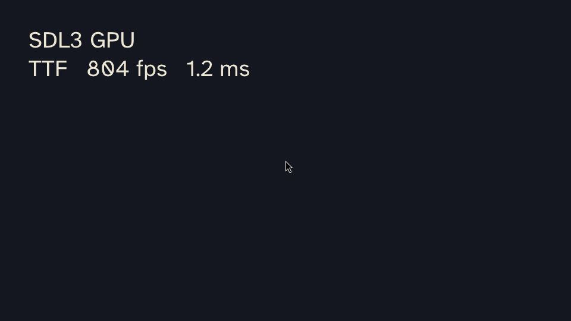

# Part 2: drawing text

A glyph is a textured quad, the same kind of quad as Part 1. This part bakes a font into one atlas, uploads it, and draws a string as a row of those quads.



The finished program is [`parts/02-text/main.cpp`](../parts/02-text/main.cpp). The steps below are how to grow it. Each step adds one small piece. Type it in, build, and check the checkpoint before you continue. If you are reading the finished file instead of typing, the same checkpoints tell you what that piece is doing. A few early snippets are temporary and the next step replaces them. Those are marked.

Press **T** in the finished program to switch fonts. `GUIDE_FRAMES=120 ./out/debug/text` quits after 120 frames.

## What you are making

Two lines:

```
SDL3 GPU
TTF   60 fps   16.7 ms
```

The first line is the title. The second line is live. **T** flips `TTF` to `HEX` and draws the same words with a hand-drawn 8×8 font.

The recommended path is [stb_truetype](https://github.com/nothings/stb) (public domain, or MIT if you prefer that option). The header in [`parts/02-text/third_party/stb_truetype.h`](../parts/02-text/third_party/stb_truetype.h) is version 1.28. Both licenses are in that file and copied in [`LICENSE.txt`](../parts/02-text/third_party/LICENSE.txt). We do not use SDL_ttf.

The font is [Atkinson Hyperlegible](https://brailleinstitute.org/freefont), regular weight, by the Braille Institute. It is SIL Open Font License 1.1. [`OFL.txt`](../parts/02-text/fonts/OFL.txt) sits next to the `.ttf`. Do not swap in a font from your operating system.

The old-school path is a fun retro option, not the modern standard. It is an original 8×8 font in [`HandFont.hpp`](../parts/02-text/HandFont.hpp). No font file, no license.

Build from the repo root:

```sh
cmake --preset debug
cmake --build --preset debug --target text
./out/debug/text
```

Visual Studio writes `out\debug\Debug\text.exe`.

---

## 1. Open a window and clear it

**Where:** `parts/02-text/main.cpp`, the whole file for now. **CMake:** the `text` target in `CMakeLists.txt` already builds this file and links `SDL3::SDL3`.

```cpp
if (!SDL_Init(SDL_INIT_VIDEO)) {
    SDL_Log("SDL_Init: %s", SDL_GetError());
    return 1;
}
SDL_Window* window = SDL_CreateWindow("SDL3 GPU text", 960, 540, SDL_WINDOW_RESIZABLE);
SDL_GPUDevice* device = SDL_CreateGPUDevice(
    SDL_GPU_SHADERFORMAT_SPIRV | SDL_GPU_SHADERFORMAT_DXIL | SDL_GPU_SHADERFORMAT_MSL,
    true, nullptr);
SDL_ClaimWindowForGPUDevice(device, window);
SDL_Log("GPU driver: %s", SDL_GetGPUDeviceDriver(device));
```

In the frame loop, acquire a command buffer and the swapchain, clear to the same dark color as Part 1 (`0.08, 0.09, 0.12`), and submit. Copy that loop from Part 1 and leave the draw out.

This is the Part 1 device again. The clear proves the window and the GPU device work before any font code can confuse you.

**Build and run: you should see** a dark empty window, and the log line `GPU driver: vulkan` (or `direct3d12`, or `metal`).

**If it doesn't work:** a missing driver usually means the shader-format flags or the GPU device came back null. Print `SDL_GetError()`. On Linux, configure needs the X11 and Vulkan packages listed in the Part 1 appendix.

## 2. Load the text shaders

**Where:** add `LoadShader` above `main`, and call it after the device exists. The HLSL is `parts/02-text/shaders/Text.vert.hlsl` and `Text.frag.hlsl`. CMake copies `Text.vert.spv`, `.dxil`, and `.msl` to `shaders/` next to the executable.

```cpp
SDL_GPUShader* vertexShader =
    LoadShader(device, {"Text.vert", SDL_GPU_SHADERSTAGE_VERTEX, 0, 1});
SDL_GPUShader* fragmentShader =
    LoadShader(device, {"Text.frag", SDL_GPU_SHADERSTAGE_FRAGMENT, 1, 0});
```

The vertex shader has one uniform buffer (the window size, `b0` in `space1`) and no samplers. The fragment shader has one sampler (`t0`/`s0` in `space2`) and no uniform buffers. Those counts have to match the HLSL or the pipeline will fail later.

`LoadShader` tries `spv`, then `dxil`, then `msl`. The entry point is `main`, except MSL, which shadercross names `main0`.

**Build and run: you should see** the same dark window. The log does not say `No usable shader variant`.

**If it doesn't work:** the loader looks next to the executable, in `shaders/Text.vert.spv` (or `.dxil` / `.msl`), not next to the source file. A wrong entry point fails inside `SDL_CreateGPUShader` and the log names the path.

## 3. Bake ASCII 32–126 into an R8 atlas

**Where:** add `BakeTtfAtlas` above `main`, and call it once after `LoadShader`. Keep the file bytes in a `std::vector<unsigned char>` that lives for the whole program. `stbtt_fontinfo` points into those bytes.

The implementation of stb lives in one C file, `parts/02-text/third_party/stb_truetype.c`:

```c
#include <stddef.h>
#define STB_TRUETYPE_IMPLEMENTATION
#include "stb_truetype.h"
```

`main.cpp` includes the header with no `#define`. Defining it in two files causes duplicate symbols.

```cpp
const int rows = stbtt_BakeFontBitmap(
    ttfBytes.data(), 0, kTtfPixelHeight, pixels.data(),
    kAtlasSize, kAtlasSize, 32, 95, baked.data());
```

`32` is the space character. `95` is the count through `~` (ASCII 126). `kTtfPixelHeight` is 48 and `kAtlasSize` is 512. The bitmap is one byte per pixel: 0 is empty, 255 is solid ink. That is the R8 atlas.

Also call `stbtt_InitFont` and `stbtt_ScaleForPixelHeight`. You need that scale in the kerning step. `stbtt_GetFontVMetrics` gives the line height.

**Build and run: you should see** the dark window, plus a log line like `TTF atlas baked (135 rows used, line height 48)`. The number of rows can differ. It must be positive.

**If it doesn't work:** `Could not load fonts/AtkinsonHyperlegible-Regular.ttf` means the post-build copy did not run, or you started the program from the wrong directory. The path is beside the executable, not the source tree. A negative return from `stbtt_BakeFontBitmap` means the atlas was too small. Raise `kAtlasSize`.

## 4. Upload the atlas

**Where:** add `UploadR8` and call it at the end of `BakeTtfAtlas`.

```cpp
info.format = SDL_GPU_TEXTUREFORMAT_R8_UNORM;
info.usage = SDL_GPU_TEXTUREUSAGE_SAMPLER;
// map, memcpy, unmap, then in a copy pass:
source.pixels_per_row = static_cast<Uint32>(width);
SDL_UploadToGPUTexture(copy, &source, &destination, false);
```

This is the Part 1 texture upload with a one-channel format. Unmap before you record the copy. `cycle` is false because this texture is uploaded once.

**Build and run: you should see** the same dark window and the same bake log. The atlas is on the GPU and nothing samples it yet.

**If it doesn't work:** a null texture and `Atlas upload failed` in the log means the create or the map failed. Check the format and that `width * height` matches the buffer you copied.

## 5. Draw one glyph

**Where:** in the frame loop, after the swapchain texture is non-null, bind the pipeline and draw six vertices for the letter **A** (glyph index `'A' - 32`). Use a hard-coded quad for now. The next steps replace it with `LayoutText`.

```cpp
const Glyph& glyph = ttfAtlas.Glyphs['A' - 32];
AppendQuad(vertices, 48.0f, 40.0f, glyph.Width, glyph.Height,
           glyph.U0, glyph.V0, glyph.U1, glyph.V1);
SDL_DrawGPUPrimitives(pass, 6, 1, 0, 0);
```

Push the window size as the vertex uniform first (`ScreenUniforms` is two floats for width and height, padded to 16 bytes). The vertex shader turns pixel positions into clip space, with y down.

Leave blending off for this step. The sampler can be linear for a moment.

**Build and run: you should see** a pale rectangle where the letter will be. The ink and the empty texels are both drawn as solid color, because alpha is ignored.

**If it doesn't work:** a missing rectangle is usually the shader path, a zero window size in the uniform, or UVs of 0,0,0,0. Log `glyph.Width` once. It should be well above 0 for `'A'`.

## 6. Turn on alpha blending

**Where:** `CreateTextPipeline`, on the color target, before you create the pipeline.

```cpp
colorTarget.blend_state.enable_blend = true;
colorTarget.blend_state.src_color_blendfactor = SDL_GPU_BLENDFACTOR_SRC_ALPHA;
colorTarget.blend_state.dst_color_blendfactor = SDL_GPU_BLENDFACTOR_ONE_MINUS_SRC_ALPHA;
colorTarget.blend_state.color_blend_op = SDL_GPU_BLENDOP_ADD;
colorTarget.blend_state.src_alpha_blendfactor = SDL_GPU_BLENDFACTOR_SRC_ALPHA;
colorTarget.blend_state.dst_alpha_blendfactor = SDL_GPU_BLENDFACTOR_ONE_MINUS_SRC_ALPHA;
colorTarget.blend_state.alpha_blend_op = SDL_GPU_BLENDOP_ADD;
```

The fragment shader writes coverage into alpha:

```hlsl
float coverage = Glyphs.Sample(GlyphSampler, texCoord).r;
return float4(0.93, 0.91, 0.84, coverage);
```

Empty texels now drop out. The letter edge fades instead of cutting a rectangle.

**Build and run: you should see** a single cream-colored **A** on the dark window.

**If it doesn't work:** if the rectangle from step 5 is still a solid block, `enable_blend` did not make it into the pipeline you bound. Rebuild the pipeline after the change. If the letter is upside down, the vertex shader's y flip is missing (`1 - pixelY / height`).

## 7. Lay out a string with advance

**Where:** add `LayoutText` and call it instead of the hard-coded **A**. Start the pen at `(48, 80)`. `80` is the baseline, not the top of the line. Each glyph's `YOff` hangs the ink off that baseline.

```cpp
const float x = penX + glyph.XOff;
const float y = penY + glyph.YOff;
if (glyph.Width > 0.0f && glyph.Height > 0.0f)
    AppendQuad(vertices, x, y, glyph.Width, glyph.Height, glyph.U0, glyph.V0, glyph.U1, glyph.V1);
penX += glyph.XAdvance;
```

`XAdvance` is how far the next character starts. A space has advance and no quad. Draw every vertex in one `SDL_DrawGPUPrimitives` call. The count is `vertices.size()`.

**Build and run: you should see** the words `SDL3 GPU` on one line.

**If it doesn't work:** letters piled on the same spot means you forgot `penX += glyph.XAdvance`. Letters far apart means the advance is still in font units. `stbtt_BakeFontBitmap` already scales `xadvance` to pixels. Use that value, not the raw kerning units.

## 8. Newlines

**Where:** the top of the loop inside `LayoutText`, before you look up a glyph.

```cpp
if (ch == '\n') {
    penX = originX;
    penY += atlas.LineHeight;
    previous = 0;
    continue;
}
```

`LineHeight` comes from `stbtt_GetFontVMetrics` times the pixel scale. Pass the string `"SDL3 GPU\nhello"`.

**Build and run: you should see** `hello` on a second line, lined up with the `S`.

**If it doesn't work:** a second line that starts at the end of the first one means `penX` was not reset to `originX`. A second line that overlaps the first means `LineHeight` is 0. Log it. It is about 48 for this font at 48 pixels.

## 9. Kerning

**Where:** inside `LayoutText`, after the newline check and before you place the glyph. `previous` is the codepoint you just drew. Reset it to 0 on a newline (step 8 already does that).

```cpp
if (kerning && kerning->Ready && previous != 0) {
    const int kern = stbtt_GetCodepointKernAdvance(&kerning->Info, previous, ch);
    penX += static_cast<float>(kern) * kerning->Scale;
}
previous = ch;
```

Kerning is a small extra nudge between a pair. `AV` wants to sit closer than the two advances say. The value from stb is in font units, so multiply by `stbtt_ScaleForPixelHeight`. The hand-drawn font passes a null kerning pointer and skips this.

**Build and run: you should see** the same title. The change is a pixel or two between some pairs, which is the point. Temporarily draw `AV AV` if you want to see it. With kerning, the second pair is the one to compare after you comment the nudge out and rebuild.

**If it doesn't work:** a huge gap or a huge overlap means you added the unscaled kerning value. It is often hundreds of font units. Multiply by `kerning->Scale` (a small fraction).

## 10. Pixel snap and nearest sampling

**Where:** the pen position in `LayoutText`, and the sampler created in `main`.

```cpp
const float x = std::floor(penX + glyph.XOff);
const float y = std::floor(penY + glyph.YOff);
```

```cpp
samplerInfo.min_filter = SDL_GPU_FILTER_NEAREST;
samplerInfo.mag_filter = SDL_GPU_FILTER_NEAREST;
samplerInfo.mipmap_mode = SDL_GPU_SAMPLERMIPMAPMODE_NEAREST;
```

`floor` lands the quad on a whole pixel. Nearest sampling does not blend neighboring atlas texels. Together the glyphs stay sharp when the pen would otherwise sit between pixels. The UVs in `BakeTtfAtlas` are inset by half a texel so nearest mode hits texel centers.

**Build and run: you should see** the same two lines, with crisp edges rather than a soft blur.

**If it doesn't work:** if the letters look fuzzy, the sampler is still linear, or the quad position still has a fraction. If they look sliced, the half-texel UV inset was applied twice.

## 11. Batch into one dynamic vertex buffer

**Where:** create one vertex buffer and one transfer buffer at startup, both `kVertexBytes` large (`128` glyphs times 6 vertices). Each frame, fill a `std::vector<Vertex>` with `LayoutText`, then upload that range before the render pass.

```cpp
void* mapped = SDL_MapGPUTransferBuffer(device, transfer, true);
std::memcpy(mapped, vertices.data(), byteCount);
SDL_UnmapGPUTransferBuffer(device, transfer);

SDL_GPUCopyPass* copy = SDL_BeginGPUCopyPass(cmd);
SDL_UploadToGPUBuffer(copy, &source, &destination, true);
SDL_EndGPUCopyPass(copy);
```

Both `cycle` flags are `true`. The GPU may still be reading last frame's vertices. Cycling hands you a fresh transfer buffer and a fresh vertex buffer instead of writing over in-flight data. One draw call then renders the whole string.

Do the copy pass and the render pass on the same command buffer. Unmap before the copy.

**Build and run: you should see** the same text as step 10. Nothing new on screen is the success case. The upload is ready for the FPS line, which changes every frame.

**If it doesn't work:** a flicker, or a frame that shows the previous string torn in half, means `cycle` was left `false` on a buffer you rewrite every frame. A blank frame after this step means `byteCount` was 0 or the draw count was still the hard-coded `6` from step 5. Draw `vertices.size()` vertices.

## 12. Title plus a live frame-time line

**Where:** the frame loop, the string you pass to `LayoutText`.

```cpp
const Uint64 nowTicks = SDL_GetTicksNS();
const float elapsedMs = static_cast<float>(nowTicks - lastTicks) / 1.0e6f;
lastTicks = nowTicks;
if (elapsedMs > 0.0f && elapsedMs < 1000.0f)
    frameMs = elapsedMs;
const float fps = frameMs > 0.0f ? 1000.0f / frameMs : 0.0f;

char message[128];
std::snprintf(message, sizeof(message), "SDL3 GPU\n%s   %.0f fps   %.1f ms",
              useHandFont ? "HEX" : "TTF", fps, frameMs);
LayoutText(vertices, atlas, kerningPtr, 48.0f, 80.0f, message);
```

`useHandFont` is still false. The `%s` prints `TTF`. The newline is step 8.

**Build and run: you should see** `SDL3 GPU` and, under it, `TTF` plus a frames-per-second number and a millisecond number. The numbers change. On a quiet machine they may sit in the hundreds. That is fine. Nothing is waiting for vsync here.

**If it doesn't work:** a number that sticks at 0 means `frameMs` never got a positive value. A number in the millions means you divided ticks wrong. `SDL_GetTicksNS` is nanoseconds. Divide by `1e6` for milliseconds.

## 13. Old-school option: hand-drawn bitmap font

This is a fun retro path, not the modern standard. Keep stb_truetype for real text. The bitmap font is here so you can see that the draw does not care where the atlas came from.

Years ago the author would take graph paper to a coffee shop, map a font pixel by pixel, and pack each row into bits for OpenGL's `glBitmap`. He wrote the rows in hex, the way the OpenGL Red Book does. The high bit is the leftmost square.

**Where:** `HandFont.hpp`. The letter **A** is the same picture as the series outline:

```cpp
// A
{
    0x3C, // 0b00111100  ..####..
    0x66, // 0b01100110  .##..##.
    0xC3, // 0b11000011  ##....##
    0xC3, // 0b11000011  ##....##
    0xFF, // 0b11111111  ########
    0xC3, // 0b11000011  ##....##
    0xC3, // 0b11000011  ##....##
    0x00, // 0b00000000  ........
},
```

Read a comment left to right and you are looking at the graph paper. `#` in the comment is a filled square. ASCII 32 through 126 are in that table, in order. The pixels are original, so this font is license-free. The running sample stays this 1-bit font, so **T** still flips between TTF and these chunky letters.

The big reason for the graph paper was shading, done in thirds. Each square was one of four levels: empty, 1/3, 2/3, or full. That is hand-made anti-aliasing, and it is still the old-school path, not the modern standard. The author spent hours on each font doing this by hand. One row of the shaded **A** below, left square first:

```text
shades    ..:++:..
levels    0  0  1  2  2  1  0  0
bits      00 00 01 10 10 01 00 00
nibbles   0000 0110 1001 0000
hex       0x0690
```

`.` is 0, `:` is 1, `+` is 2, `#` is 3. Group the bits by fours and you can read the hex. The 2-bit numbers are cheap for the computer. What is slow is the person shading the squares and writing the hex.

```cpp
// Shaded "A". Still old-school. Not what the T key draws.
constexpr uint16_t kShadedA[8] = {
    0x0690, // ..:++:..
    0x1EB4, // .:#++#:.
    0x6C39, // :+#..#+:
    0xB00E, // +#....#+
    0xFFFF, // ########
    0xB00E, // +#....#+
    0xB00E, // +#....#+
    0x0000, // ........
};
```

Expand a row into the same R8 atlas. Each level times 85 is the alpha byte: 0, 85, 170, or 255.

```cpp
for (int x = 0; x < 8; ++x) {
    const int level = (row >> (14 - 2 * x)) & 0x3;
    pixels[x] = static_cast<Uint8>(level * 85);
}
```

**Where:** `BakeHandAtlas` expands the 1-bit rows into the same kind of R8 atlas as the TTF bake. A 1 becomes 255, a 0 stays 0. The glyphs are scaled by 4 so each font pixel is a 4×4 block on screen. Advance is `8 * 4`. There is no kerning. Upload with the same `UploadR8`.

**Where:** the frame loop, edge-detect the T key and pick an atlas.

```cpp
const bool tDown = keys[SDL_SCANCODE_T];
if (tDown && !tWasDown)
    useHandFont = !useHandFont;
tWasDown = tDown;

const Atlas& atlas = useHandFont ? handAtlas : ttfAtlas;
const TtfKerning* kerningPtr = useHandFont ? nullptr : &kerning;
```

`LayoutText`, the vertex buffer, the pipeline, and the sampler stay the same. Only the atlas and the glyph metrics change.

**Build and run: you should see** the TTF title from step 12. Press **T**. The second line starts with `HEX`, and both lines become chunky 8×8 letters. Press **T** again and the smooth atlas comes back.

**If it doesn't work:** if T does nothing, you are reading the key once per frame without remembering the previous frame, so it toggles every frame and looks stuck. Keep `tWasDown`. If the HEX letters are a solid block, the bit test is reversed. Bit 7 is the left square: `bits & (1u << (7 - gx))`.

---

## What you can check against

The finished files:

- [`parts/02-text/main.cpp`](../parts/02-text/main.cpp) is the program at the end of step 13.
- [`parts/02-text/shaders/Text.vert.hlsl`](../parts/02-text/shaders/Text.vert.hlsl) and [`Text.frag.hlsl`](../parts/02-text/shaders/Text.frag.hlsl) are the shaders. SPIR-V, DXIL, and MSL are committed beside them.
- [`parts/02-text/fonts/`](../parts/02-text/fonts/) is Atkinson Hyperlegible and `OFL.txt`.
- [`parts/02-text/third_party/`](../parts/02-text/third_party/) is stb_truetype and its license note.

Part 1's `quad` target is unchanged. `cmake --build --preset debug` builds both.
